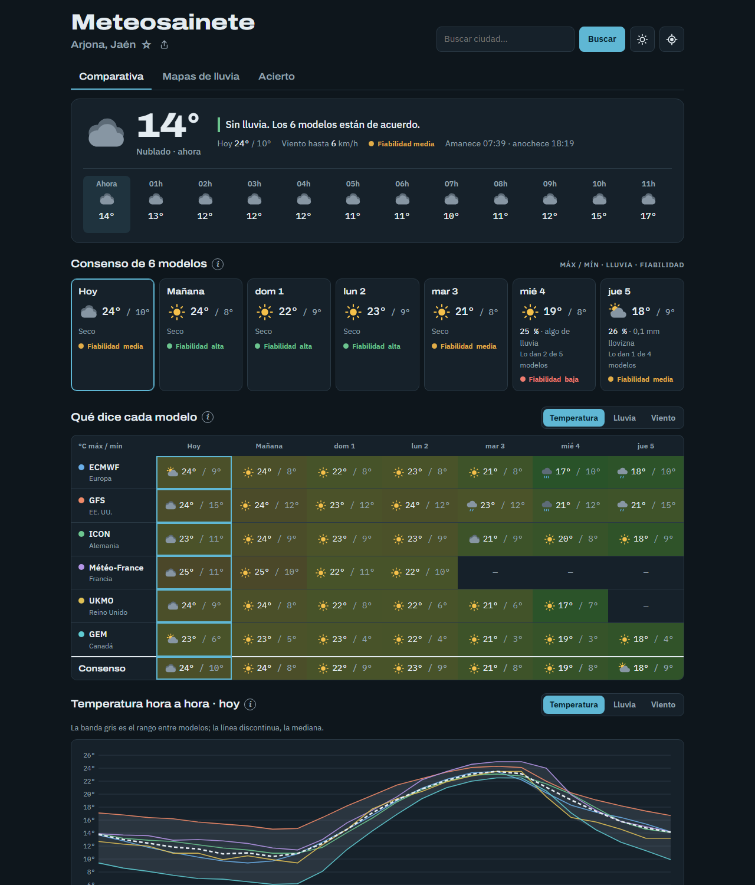
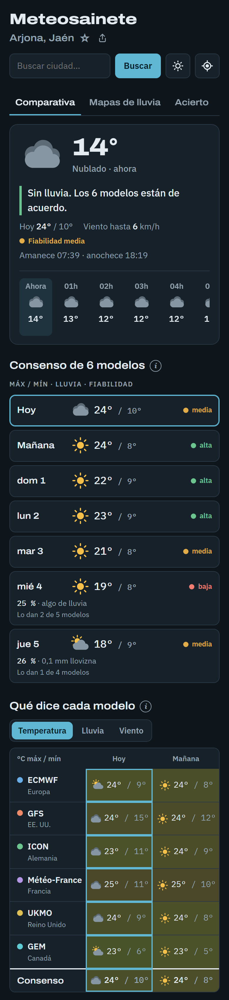
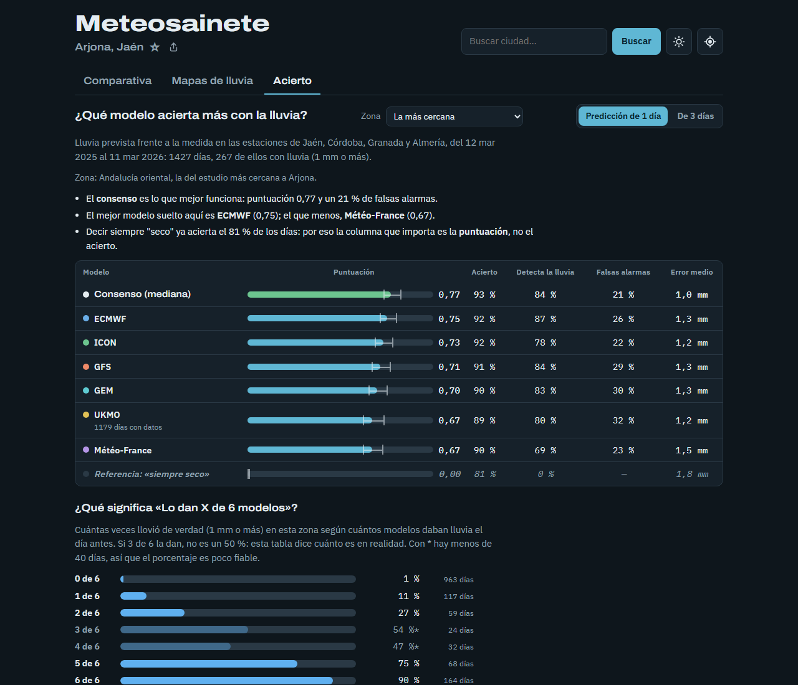

# Meteosainete

Cada web del tiempo da una predicción distinta, pero casi todas se basan en los
mismos pocos **modelos meteorológicos**. Meteosainete compara directamente esos
modelos, los pone uno al lado del otro y calcula un **consenso** con un
indicador de **fiabilidad**: si los modelos coinciden, te puedes fiar más.

**Web:** <https://angelmou42.github.io/meteosainete/>

<p>
  
  
</p>

## Qué muestra

- **Bloque "Ahora"**: temperatura y cielo de la hora actual según el consenso,
  con icono propio (SVG), la frase de lo que queda de hoy, máxima, mínima,
  viento, fiabilidad, salida y puesta de sol, y una tira con las **próximas
  12 horas** (icono, temperatura y lluvia).
- **Avisos propios** en cada día (heladas, calor, viento fuerte, lluvia
  fuerte) calculados con el consenso y marcados como no oficiales.
- **Frase resumen** del día elegido, por ejemplo *"Lluvia débil de 15 a 19 h.
  5 de 6 modelos dan algo de lluvia."* Para hoy solo cuenta la lluvia que
  queda por venir.
- **Franja de 7 días** con el consenso: icono, máxima y mínima (mediana de los
  modelos) y fiabilidad. Los días de lluvia añaden probabilidad, mm, horas y
  cuántos modelos la dan; los secos solo dicen "Seco". En el móvil es una
  lista vertical.
- **Tabla modelo × día** con pestañas Temperatura / Lluvia / Viento y una fila
  final de consenso. En Temperatura, cada celda lleva el icono que da ese
  modelo, para ver de un vistazo si discrepan.
- **Gráfico hora a hora** del día elegido, interactivo (ratón o dedo), con
  tres pestañas:
  - *Temperatura*: una línea por modelo, una banda gris con el rango entre
    modelos y la mediana discontinua.
  - *Lluvia*: barras con la mediana de los modelos y una raya del mínimo al
    máximo; debajo, una fila por modelo con cada hora coloreada según los mm,
    para ver si coinciden en el "cuándo".
  - *Viento*: como la temperatura, con el viento medio de cada modelo.
- **Mapas de lluvia** en su propia pestaña (enlace directo: `#mapa`):
  - **Por día y hora**: mapa propio con los 6 modelos, botones de día y una
    barra de hora. Al pulsar un punto muestra los mm previstos. Si en la
    Comparativa se eligió un día, el mapa se abre en ese día a mediodía.
  - **Windy animado**: mapa incrustado de [Windy](https://www.windy.com/)
    (ECMWF, GFS e ICON-EU), con más detalle pero con su propia línea de tiempo.
- **Acierto de cada modelo** con la lluvia (pestaña "Acierto", enlace
  directo: `#acierto`), calculado con un año de datos reales.
- **Buscador con sugerencias** mientras se escribe (con teclado: ↑ ↓, Intro,
  Esc) y accesos rápidos a las **ciudades recientes y favoritas** (★).
- **Botones ⓘ** con las explicaciones (consenso, fiabilidad, modelos y
  gráfico) justo donde hacen falta, con la Popover API del navegador.
- **Modo claro u oscuro**: sigue al sistema y se puede cambiar con un botón.
- **Esqueleto de carga** mientras llegan los datos y **pestañas manejables
  con las flechas del teclado** (patrón de pestañas de WAI-ARIA).
- **Instalable como app (PWA)** con su icono, y **sin conexión**: la página
  se abre desde la caché y muestra la última predicción descargada con un
  aviso de cuándo se guardó.
- **Usar mi ubicación** (GPS del navegador, redondeada a unos 1 km).
- **Compartir**: en el móvil abre el menú de compartir del sistema; en el
  ordenador copia el enlace de la ciudad.
- **Ciudad en la URL** (`?lugar=…&lat=…&lon=…`) para compartir el enlace de
  un sitio concreto.
- Recuerda la **última ciudad** buscada (localStorage). La primera vez se
  abre en Arjona (Jaén).

## Modelos

| Modelo        | Origen       | Notas |
|---------------|--------------|-------|
| ECMWF IFS     | Europa       | |
| GFS           | EE. UU.      | |
| ICON          | Alemania     | |
| Météo-France  | Francia      | Unos 4 días de alcance. No publica probabilidad de lluvia. |
| UKMO          | Reino Unido  | |
| GEM           | Canadá       | |

Comprobado con datos reales (octubre de 2026): todos publican
`precipitation_probability_max` salvo Météo-France.

## ¿Qué modelo acierta más? (análisis)

[`analisis/verificacion_lluvia.py`](analisis/verificacion_lluvia.py) compara la
lluvia que cada modelo predijo 1 y 3 días antes con la medida por **48
estaciones de AEMET** agrupadas en **13 zonas** de clima parecido, durante un
año (12/03/2025 – 11/03/2026: 17 052 días-estación, 4118 con lluvia).

- **Predicciones pasadas:** API *Previous Runs* de Open-Meteo
  (`precipitation_previous_dayN`).
- **Lluvia medida:** datos diarios de [Meteostat](https://meteostat.net/).
- **Día de lluvia:** 1 mm o más. Antes de comparar, el script comprueba con
  los datos a qué hora cierran el día las estaciones (de 06 a 06 UTC).
- **Métricas:** acierto, días de lluvia detectados, falsas alarmas, error en
  mm e **índice de Heidke** (acierto descontando el azar), con un margen de
  error del 90 % calculado por *bootstrap* remuestreando fechas.

Índice de Heidke con 1 día de antelación (más alto = mejor):

| Zona | Consenso | Mejor modelo suelto |
|------|---------:|---------------------|
| Toda España | **0,73** | ECMWF / ICON 0,68 |
| Galicia | **0,81** | ECMWF 0,78 |
| Cantábrico | **0,69** | ICON 0,65 |
| Castilla y León | **0,77** | ECMWF / UKMO 0,73 |
| Valle del Ebro y Navarra | **0,71** | ECMWF 0,65 |
| Cataluña | **0,64** | GEM 0,61 |
| Madrid y alrededores | **0,70** | ICON / Météo-France 0,69 |
| Castilla-La Mancha | **0,73** | ECMWF 0,72 |
| Comunidad Valenciana y Murcia | **0,62** | ECMWF 0,60 |
| Extremadura | **0,76** | ECMWF 0,76 |
| Andalucía occidental | **0,76** | ECMWF 0,75 |
| Andalucía oriental | **0,77** | ECMWF 0,75 |
| Baleares | **0,63** | GFS 0,62 |
| Canarias | **0,57** | GEM 0,47 |

**El consenso es lo mejor en las 13 zonas**, y el mejor modelo suelto cambia
de una zona a otra: por eso la web compara modelos en lugar de elegir uno.
La pestaña "Acierto" muestra la zona más cercana a la ciudad que se está
viendo (o la que se elija), y toda España si está a más de 150 km de las
estaciones.

**¿Qué significa «Lo dan X de 6 modelos»?** El mismo script cuenta cuántas
veces llovió de verdad (1 mm o más) según cuántos modelos daban lluvia el día
antes. En toda España:

| Modelos que dan lluvia | 0 | 1 | 2 | 3 | 4 | 5 | 6 |
|---|---:|---:|---:|---:|---:|---:|---:|
| Llovió de verdad | 2 % | 17 % | 33 % | 45 % | 59 % | 72 % | 91 % |

La web usa esta tabla en la frase de cada día ("días como este acabaron con
lluvia el 45 % de las veces"), con la de la zona si tiene bastantes días y
la de España si no.

```bash
python analisis/verificacion_lluvia.py
```

Genera `resultados.csv` (todos los números) y `resultados.json`, que es lo que
lee la pestaña "Acierto": si se repite el análisis, la web se actualiza sola.
Las descargas se guardan en `analisis/datos/`, que no se sube al repositorio.

**¿Consenso ponderado?** [`analisis/consenso_ponderado.py`](analisis/consenso_ponderado.py)
prueba a dar más peso a los modelos que más aciertan (mediana ponderada por
su índice de Heidke). Para que la prueba sea justa, los pesos se calculan con
la mitad de los meses y se evalúan con la otra mitad (validación cruzada), y
la diferencia se mide día a día con *bootstrap*. Con las 48 estaciones:

| Con 1 día de antelación | Heidke | Diferencia con la mediana (90 %) |
|---|---:|---|
| Mediana normal (la de la web) | **0,730** | |
| Mediana ponderada | 0,723 | −0,007 (−0,012 a −0,003) |
| Solo ECMWF | 0,685 | −0,045 (−0,067 a −0,024) |

Ponderar no mejora (con 3 días queda empatado: +0,003, intervalo que
incluye el 0), y la mediana de los 6 modelos gana con claridad al mejor
modelo suelto. Los modelos aciertan de forma muy parecida y la mediana ya
descarta al que se desvía, así que la web mantiene la mediana normal.

## Decisiones de diseño

- **Comparar modelos, no webs.** Sin scraping: los datos salen de la API de
  [Open-Meteo](https://open-meteo.com/), que es gratuita, no necesita clave y
  permite llamadas desde el navegador (CORS). Una sola petición trae los 6
  modelos; la API añade un sufijo a cada variable
  (`temperature_2m_max_ecmwf_ifs025`) y `fetchForecast()` lo reorganiza por
  modelo.
- **Mediana en lugar de media.** Si un modelo se desvía mucho, la mediana casi
  no se mueve; la media sí.
- **Fiabilidad.** *Alta* si las máximas difieren ≤ 2 °C y todos los modelos
  coinciden en si llueve (≥ 1 mm). *Media* hasta 4 °C o si una minoría
  discrepa sobre la lluvia. *Baja* en el resto.
- **Huecos honestos.** Si un modelo no llega a un día, se ve "—" y no cuenta
  para el consenso ni para el "Lo dan X de N".
- **Probabilidad estimada.** Para Météo-France se muestra una estimación a
  partir de los mm, marcada con "≈" y en cursiva. Es orientativa, por eso
  **no entra en el consenso**.
- **Solo datos reales.** Si la API falla, se muestra un error claro con un
  botón de reintentar, nunca datos inventados.
- **Dos mapas, cada uno para lo que hace mejor.** El iframe de Windy no deja
  elegir la hora desde fuera, así que hay un mapa propio: una rejilla de
  8 × 16 puntos de Open-Meteo pintada en un `<canvas>` con interpolación
  bilineal sobre [Leaflet](https://leafletjs.com/). Se descargan los 7 días
  de golpe, así que cambiar de día u hora es instantáneo. Windy se mantiene
  como vista animada con más detalle.
- **Cuidar la cuota de Open-Meteo.** Cada punto de la rejilla cuenta como una
  llamada (límite gratuito: 600 por minuto y usuario), por eso la rejilla es
  pequeña y cada modelo descargado se guarda una hora en `sessionStorage`.
- **Nada pesado hasta que hace falta.** Leaflet, las rejillas y Windy solo se
  descargan al abrir la pestaña de mapas. Leaflet se carga con SRI
  (`integrity`) para que el navegador lo rechace si el CDN lo alterase.
- **Módulos ES.** `core.js` tiene la configuración, el estado y las funciones
  puras (mediana, consenso, etiquetas…); `app.js`, `map.js` y `acierto.js`
  importan de él. Así no dependen del orden de carga y lo puro se puede
  probar en Node sin navegador.
- **Versiones en CSS y JS** (`style.css?v=23`, y para los módulos un
  `importmap` en `index.html`). GitHub Pages deja que el
  navegador guarde los archivos 10 minutos; al cambiar el número tras cada
  cambio importante, nadie ve HTML nuevo mezclado con CSS o JS viejos. Al
  subir la versión hay que subir también `CACHE` en `sw.js`.
- **Iconos que no contradicen al texto.** El icono de cada día no sale del
  "código del tiempo" de un solo modelo, sino del mismo criterio que la frase:
  lluvia si más de la mitad de los modelos la dan en alguna hora; tormenta,
  nieve o niebla si la mayoría lo dicen; y si no, la nubosidad media
  (mediana de los modelos) durante el día.
- **Sin conexión, datos viejos pero avisados.** La regla "solo datos reales"
  se mantiene: si no hay red, se enseña la última predicción *real* que se
  descargó, con un aviso de la fecha y un botón de reintentar. Nunca datos
  inventados. Los iconos PNG se generan con un script en Python sin
  librerías (PNG escrito a mano con `zlib`).
- **Sin compilación.** HTML, CSS y JavaScript a pelo, sin npm: se abre tal
  cual y se publica en GitHub Pages sin configuración. La única librería
  (Leaflet) se carga desde un CDN.

## Estructura

```
index.html   Estructura de la página
style.css    Estilos (modo claro/oscuro automático, adaptado a móvil)
core.js      Configuración, estado y funciones puras (consenso, mediana…)
app.js       Módulo principal: carga de datos, bloque Ahora, tarjetas, tabla y pestañas
charts.js    Gráficos horarios interactivos (temperatura, lluvia y viento)
map.js       Mapas de lluvia (mapa propio con Leaflet y Windy)
acierto.js   Pestaña "Acierto" (lee analisis/resultados.json)
icons.js     Iconos del tiempo en SVG
places.js    Buscador con sugerencias, recientes y favoritas
sw.js        Service worker: caché para abrir la web sin conexión
manifest.webmanifest, img/   Datos e iconos de la app instalable
herramientas/                Scripts para generar los iconos y las capturas del README
analisis/    Análisis de acierto en Python, sus resultados y sus tests
tests/       Tests de la web (node --test)
.github/     GitHub Actions: ejecuta todos los tests en cada push
```

## Tests

Sin instalar nada (Node 20 o superior y Python 3.10 o superior):

```bash
node --test
```

```bash
python -m unittest discover analisis
```

GitHub Actions los ejecuta en cada `git push`; el resultado aparece en la
pestaña *Actions* del repositorio.

## Ejecutarlo en local

Hace falta un servidor estático (los módulos ES no funcionan abriendo el
archivo con doble clic), por ejemplo:

```bash
python -m http.server 8000
```

y abrir <http://localhost:8000>.


## Ideas para el futuro

- Añadir la predicción oficial de AEMET (API AEMET OpenData) como séptima fila,
  con un pequeño proxy para no exponer la clave.
- Probabilidad de lluvia por horas en el gráfico.
- Radar de lluvia en tiempo real (AEMET o RainViewer) junto al mapa.

## Capturas

Las capturas del README se generan con
[`herramientas/capturas.mjs`](herramientas/capturas.mjs): abre Edge o Chrome
sin ventana y lo maneja con su protocolo de depuración (el WebSocket que trae
Node), sin instalar nada. Con la web servida en local:

```bash
node herramientas/capturas.mjs
```



## Créditos

Datos meteorológicos de [Open-Meteo](https://open-meteo.com/) bajo licencia
CC BY 4.0. Observaciones de AEMET a través de Meteostat. Mapa base de Esri.
Mapa animado de Windy.
